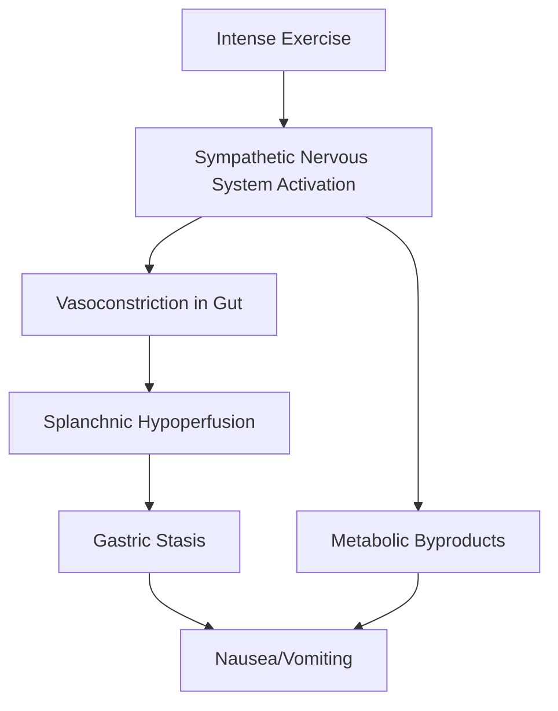

# The Science of Exercise-Induced Nausea: Why Pushing Your Limits Can Make You Sick

It is a familiar scene in high-intensity training circles: an athlete collapses after a grueling workout, or a long-distance runner reaches the finish line only to double over in a bout of dry heaving. While often dismissed as a sign of a "good workout," exercise-induced nausea is a physiological response that warrants a closer look.

Understanding why the body reacts to intense physical exertion with nausea requires us to delve into the complex interplay between our digestive system, our nervous system, and our circulatory demands.

## The Physiological Mechanisms: Why the Gut Shuts Down

When you engage in high-intensity interval training (HIIT), heavy lifting, or endurance running, your body undergoes a massive redistribution of resources. This is primarily governed by the autonomic nervous system—the "fight or flight" response.

### 1. Splanchnic Hypoperfusion (The "Gut Shutdown")
During rest, a significant portion of your blood volume is directed toward the digestive system to process nutrients. However, when you perform strenuous exercise, your body prioritizes the skeletal muscles and the heart. To accommodate this, the body triggers vasoconstriction in the splanchnic region (the blood vessels supplying the stomach and intestines). 

This reduction in blood flow, known as splanchnic hypoperfusion, can lead to ischemia in the gut lining. The stomach, deprived of adequate blood flow, effectively "shuts down," leading to sensations of nausea, cramping, or even vomiting.

### 2. The Sympathetic Nervous System Overdrive
Intense exercise triggers a surge in catecholamines, such as adrenaline. While these hormones prepare the muscles for action, they also inhibit gastric emptying and intestinal motility. If you have food in your stomach, it sits there, undigested, causing physical discomfort that the brain may interpret as a signal to purge.

### 3. Metabolic Shifts
As exercise intensity increases, the body relies more on anaerobic metabolism, which breaks down glucose without using oxygen. This process can lead to the accumulation of metabolic byproducts. The body’s chemoreceptors detect shifts in blood chemistry and may trigger the vomit reflex as a protective mechanism to restore homeostasis.

## Comparison: Normal Physiological Response vs. Clinical Warning Signs

It is vital to distinguish between a temporary reaction to intensity and a signal of underlying pathology.

| Feature | Exercise-Induced Nausea (Common) | Clinical Warning (Concerning) |
| :--- | :--- | :--- |
| **Onset** | During or immediately after peak intensity | Persistent, occurring at low intensities |
| **Duration** | Subsides within 15–30 minutes | Lasts hours or days |
| **Associated Symptoms** | Mild dizziness, heavy breathing | Chest pain, fainting, confusion, bloody vomit |
| **Cause** | Blood flow redistribution | Cardiac issues, electrolyte imbalance, heatstroke |

## Practical Examples and Mitigation Strategies

If you find yourself frequently experiencing nausea, consider these common triggers and how to adjust your routine:

*   **The "Pre-Workout" Trap:** Consuming a large meal shortly before a high-intensity session is a primary cause of nausea. The stomach is forced to compete with muscles for blood flow. 
    *   *Strategy:* Opt for simple carbohydrates well before training and save heavy protein or fat for post-workout recovery.
*   **Dehydration and Electrolytes:** Dehydration reduces plasma volume, making it harder for the heart to pump blood to both the muscles and the skin for cooling. Furthermore, exercise-associated hyponatremia—a decrease in sodium levels—can occur during or after prolonged activity.
    *   *Strategy:* Ensure adequate electrolyte intake to maintain fluid-electrolyte balance.
*   **Intensity Spikes:** Jumping into a high-intensity program without a base level of cardiovascular fitness can shock the autonomic nervous system.
    *   *Strategy:* Utilize a gradual progressive overload approach, allowing the body’s vascular system to adapt to the demands of high-intensity output.

### Infographic: The Nausea Feedback Loop

## When to Seek Medical Attention
While mild nausea after a strenuous effort is common, it should not be a regular occurrence. If nausea is accompanied by chest pain, severe headache, or loss of consciousness, you must stop exercising immediately and seek medical evaluation. These can be indicators of serious conditions, such as cardiac issues or severe electrolyte disorders.

In conclusion, exercise-induced nausea is often a signal from your body that your current intensity is outpacing your physiological capacity to supply oxygen to non-essential organs. By managing your nutrition, hydration, and training progression, you can minimize these episodes and focus on sustainable performance gains.

***

**json_meta**
{
  "title": "Why Exercise Makes You Nauseous: The Science of Gut Shutdown",
  "description": "An exploration of why high-intensity exercise causes nausea, covering physiological mechanisms like splanchnic hypoperfusion, catecholamine surges, and practical mitigation strategies.",
  "tags": ["fitness", "physiology", "health", "exercise science", "nutrition"]
}

## References

- [Euphoria](https://en.wikipedia.org/wiki/Euphoria)
- [Exercise](https://en.wikipedia.org/wiki/Exercise)
- [Vomiting](https://en.wikipedia.org/wiki/Vomiting)
- [Exercise-induced nausea](https://en.wikipedia.org/wiki/Exercise-induced%20nausea)
- [502 Functional Splanchnic Hypoperfusion Precedes Intestinal Epithelial Cell Damage During Strenuous Exercise](https://doi.org/10.1016/s0016-5085(10)60328-9)
- [Figure 2: CHO oxidation rate during high intensity intermittent exercise.](https://doi.org/10.7717/peerj.3769/fig-2)
- [Effect of prior eccentric exercise on muscle lactate accumulation during high intensity exercise](https://doi.org/10.31274/rtd-20200716-17)