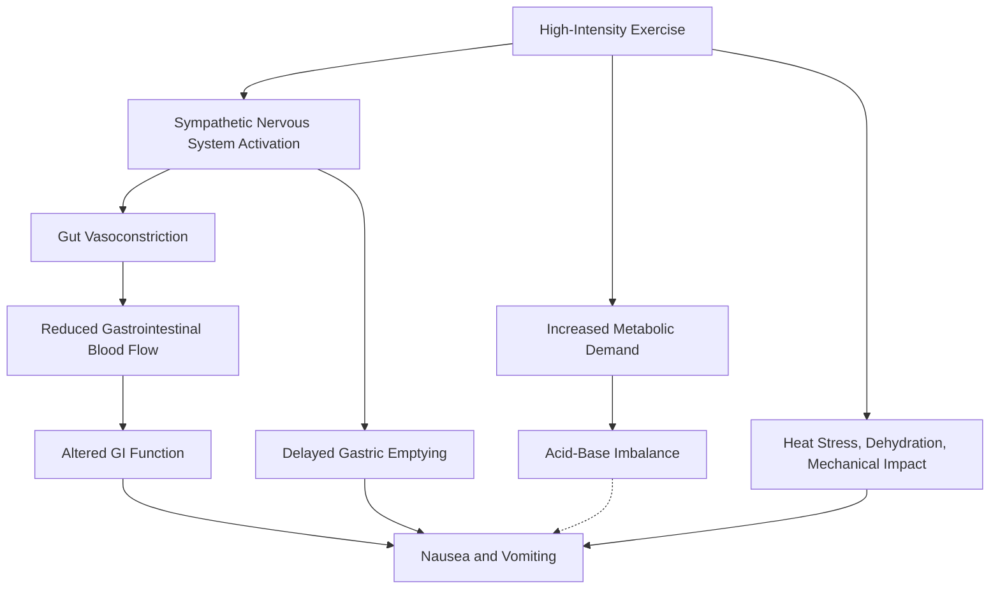

# The Science of Exercise-Induced Nausea: Why Pushing Your Limits Can Make You Sick

It is a familiar scene in high-intensity training circles: an athlete collapses after a grueling workout, or a long-distance runner reaches the finish line only to double over in a bout of dry heaving.

While often dismissed as a sign of a "good workout," **exercise-induced nausea and vomiting are not indicators of performance, but rather physiological responses to high-intensity physical activity.**

During intense exercise, the body must efficiently redistribute limited resources. This process involves reduced blood flow to the digestive system, shifts in autonomic nervous system activity, and significant strain on energy metabolism and thermoregulation. Exercise-induced nausea and vomiting are the result of these complex, interacting changes.

## Physiological Mechanisms: Why Intense Exercise Triggers Nausea

### 1. Splanchnic Hypoperfusion
At rest, the digestive system receives a significant amount of blood for digestion and nutrient absorption. However, during high-intensity interval training (HIIT), heavy lifting, or endurance running, the body prioritizes blood flow to working muscles and the skin for thermoregulation. Through sympathetic nervous system activation, blood vessels in the gut constrict, reducing blood flow to the stomach and intestines—a phenomenon known as splanchnic hypoperfusion.

It is important to note that **nausea does not cause this vasoconstriction; rather, vasoconstriction is a normal physiological response to intense exercise.** While this is a standard adaptation, excessive or prolonged reduction in blood flow can lead to ischemic stress in the gut lining, potentially increasing intestinal permeability and contributing to abdominal discomfort and nausea.

### 2. Sympathetic Nervous System Activation and Gastric Motility
Intense exercise activates the sympathetic nervous system, often called the "fight-or-flight" response. This triggers the release of catecholamines like adrenaline and noradrenaline. While these hormones boost heart rate and support muscle activity, they also affect digestive function, often delaying gastric emptying. If you have consumed food shortly before exercise, the combination of delayed emptying and the mechanical stress of movement increases the likelihood of nausea.

### 3. Metabolic Changes: Does Lactate Cause Nausea?
Lactate is a common byproduct of high-intensity exercise. While historically blamed for muscle acidity and discomfort, modern physiology views it differently. Lactate is an energy source, not the primary cause of systemic acidification. The metabolic acidosis observed during intense exercise is more accurately linked to the accumulation of hydrogen ions (H⁺) during ATP turnover. Research, such as a 2019 study in *Physiological Reports*, has shown a correlation between post-exercise nausea and concentrations of lactate and hydrogen ions. However, correlation does not equal causation; it is more accurate to state that **metabolic changes associated with high-intensity exercise may contribute to nausea.**

### 4. Heat, Dehydration, and Mechanical Stress
Additional factors include high temperatures and humidity, which increase thermoregulatory strain, and dehydration, which reduces circulating blood volume. Furthermore, repetitive mechanical impact—such as in running—can exacerbate gastrointestinal distress. Energy depletion during prolonged exercise can also play a role.

## Exercise-Induced Nausea vs. Clinical Warning Signs

While mild nausea can be a common response, it should not be ignored if it becomes severe or persistent.

| Feature | Temporary Exercise-Related Response | Signal Requiring Medical Evaluation |
| :--- | :--- | :--- |
| **Onset** | During or immediately after intense exercise | Occurs even at low intensities |
| **Recovery** | Improves with rest | Persistent or recurring vomiting |
| **Associated Symptoms** | Mild nausea, abdominal discomfort | Chest pain, fainting, confusion, severe headache |
| **Abdominal Signs** | Temporary discomfort | Severe pain, bloody vomit, or bloody stool |
| **Hydration** | Able to drink after symptoms subside | Persistent vomiting preventing fluid intake |

*Note: This table is for reference only and does not replace professional medical diagnosis. Symptoms like fainting, chest pain, or bloody vomit require immediate attention.*

## Practical Strategies to Reduce Nausea

### 1. Timing and Composition of Pre-Workout Meals
Avoid large meals immediately before high-intensity training. Aim to finish general meals 2–3 hours prior. If you need energy right before, choose small amounts of easily digestible carbohydrates. High-fat or high-fiber foods may delay gastric emptying.

### 2. Proper Hydration and Electrolyte Management
Dehydration worsens gastrointestinal symptoms, but over-hydration can lead to exercise-associated hyponatremia (low blood sodium), which also causes nausea. Tailor your fluid and electrolyte intake to your sweat rate, exercise duration, and environmental conditions.

### 3. Gradual Progression of Intensity
Avoid sudden spikes in training intensity. Gradually increasing your workload allows your cardiovascular and metabolic systems to adapt, reducing the physiological shock that can trigger nausea.

### 4. Environmental and Supplement Considerations
High heat and humidity increase physiological strain; adjust your intensity accordingly. Be cautious with supplements like high-dose caffeine or sodium bicarbonate, which can irritate the gastrointestinal tract in some individuals.

## Beta-Alanine: Can It Prevent Nausea?

Beta-alanine is known for buffering muscle acidity by increasing carnosine levels, which can improve performance in high-intensity exercise lasting 1–4 minutes. However, **there is currently insufficient clinical evidence to suggest that beta-alanine prevents exercise-induced nausea or vomiting.** While it may help with muscle-level buffering, it does not directly address splanchnic hypoperfusion or delayed gastric emptying. Furthermore, the most common side effect of beta-alanine is paresthesia (tingling of the skin).

## Infographic: Physiological Pathways of Exercise-Induced Nausea

## Conclusion: Nausea Is Not a Badge of Honor

Exercise-induced nausea is a complex physiological response to stress. It is not a sign that you have "worked hard enough," but rather a signal that your body is struggling to manage the demands placed upon it. If you experience this frequently, use it as a cue to re-evaluate your training intensity, nutrition, and recovery protocols. **The goal of training is not to push your body to the point of failure, but to progressively raise your limits through consistent, manageable stimulus and recovery.**

## References

1. Costa et al. (2025). *Sports Dietitians Australia and Ultra Sports Science Foundation Joint Position Statement: A Practitioner Guide to the Prevention and Management of Exercise-Associated Gastrointestinal Perturbations and Symptoms*. Sports Medicine. https://doi.org/10.1007/s40279-025-02186-6
2. Merrells et al. (2019). *Role of lactic acidosis as a mediator of sprint-mediated nausea*. Physiological Reports. https://pubmed.ncbi.nlm.nih.gov/31724342/
3. Trexler et al. (2015). *International Society of Sports Nutrition Position Stand: Beta-Alanine*. Journal of the International Society of Sports Nutrition. https://doi.org/10.1186/s12970-015-0090-y
4. Dolan et al. (2019). *A Systematic Risk Assessment and Meta-Analysis on the Use of Oral β-Alanine Supplementation*. Advances in Nutrition. https://pubmed.ncbi.nlm.nih.gov/30980076/
5. National Institutes of Health, Office of Dietary Supplements. *Dietary Supplements for Exercise and Athletic Performance — Health Professional Fact Sheet*. https://ods.od.nih.gov/factsheets/ExerciseandAthleticPerformance-HealthProfessional/
