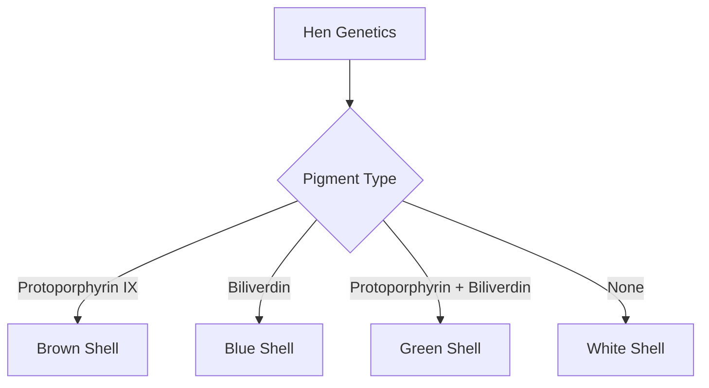

# The Spectrum of the Shell: Why Egg Colors Vary and What It Means for Your Health

When you stand in the dairy aisle of a grocery store, you are often greeted by a wall of cartons containing eggs of various hues—pristine white, deep brown, speckled blue, and even olive green. For many consumers, the choice between a white egg and a brown egg is shrouded in myths, ranging from the belief that brown eggs are "more natural" to the idea that they are healthier or richer in nutrients. 

To understand why eggs come in different colors, we must look beyond the carton and into the biology of the hen. Understanding these mechanisms not only satisfies our curiosity but also helps us make informed decisions about the food we put on our tables.

## The Biological Mechanism: How Hens Paint Their Eggs

The color of an eggshell is determined almost entirely by the genetics of the hen. Regardless of the shell color, all eggs start out as white inside the hen’s oviduct. The pigment is applied to the shell during the final stages of the egg-formation process.

### Pigmentation Processes
The primary pigments involved in egg coloration are protoporphyrin IX and biliverdin. 

1.  **White Eggs:** These eggs lack pigment. The hen’s genetics do not trigger the deposition of color onto the shell as it passes through the uterus.
2.  **Brown Eggs:** These eggs are coated with protoporphyrin IX, a pigment derived from hemoglobin. This pigment is applied to the shell in the final hours of formation. 
3.  **Blue and Green Eggs:** These colors are produced by biliverdin, a pigment that results from the breakdown of red blood cells. Blue eggs, such as those laid by the Araucana or Ameraucana breeds, have this pigment deposited throughout the shell. Green eggs are typically the result of a blue-egg-laying hen that also applies a layer of brown protoporphyrin on top, resulting in an olive or mossy appearance.

### Visualizing the Pigment Deposition
The following diagram illustrates the relationship between genetics and pigment application:

## Nutritional Myths vs. Scientific Reality

A common misconception is that the color of the shell dictates the nutritional profile of the egg. From a strictly biological and chemical standpoint, there is no link between shell color and nutritional value.

The nutrient content of an egg—including protein, vitamins, and minerals—is primarily determined by the hen's diet and living conditions, not the color of the shell. A hen fed a diet rich in specific nutrients will produce an egg with a different nutrient profile than a hen fed a standard grain-based diet, regardless of whether that hen lays white or brown eggs.

### Comparison Table: Egg Shell Characteristics

| Feature | White Shell | Brown Shell | Blue/Green Shell |
| :--- | :--- | :--- | :--- |
| **Primary Pigment** | None | Protoporphyrin IX | Biliverdin |
| **Nutritional Value** | Identical | Identical | Identical |
| **Common Breeds** | Leghorn | Rhode Island Red | Ameraucana |

## Historical and Economic Context

Why do we see so many white eggs in some regions and brown in others? The answer is largely economic and cultural. 

Historically, different breeds were favored in different regions based on climate and feed availability. In the United States, the White Leghorn became the industry standard for commercial egg production because these birds are efficient layers. Because they lay white eggs, white eggs became the commercial standard. In other parts of the world, heavier breeds that lay brown eggs were historically more common. Today, the preference for one over the other is often purely cultural, as there is often a cultural preference for one color over another despite the lack of nutritional difference.

## Practical Considerations for the Consumer

If you are choosing eggs at the store, ignore the color. Instead, focus on these factors:

1.  **Production Method:** Look for labels that indicate the hens' living conditions, as these can influence the quality of the egg.
2.  **Freshness:** Check the "sell-by" or "best-by" date. The quality of the egg degrades over time.
3.  **Shell Integrity:** Regardless of color, ensure the shell is clean and free of cracks, as cracks can allow contaminants to enter the egg.

In conclusion, the colorful array of eggs in your local market is a fascinating display of avian genetics. While the pigments biliverdin and protoporphyrin create beautiful shells, they are merely a biological byproduct. When it comes to your health, focus on the hen’s lifestyle and diet rather than the color of the shell she produces.

## References

- [Eggs as food](https://en.wikipedia.org/wiki/Eggs%20as%20food)
- [Egg](https://en.wikipedia.org/wiki/Egg)
- [Reptile](https://en.wikipedia.org/wiki/Reptile)
- [Eggshell (color)](https://en.wikipedia.org/wiki/Eggshell%20%28color%29)
- [Why Do Soils Have Different Colors and Smell?](https://doi.org/10.1007/978-3-031-50777-9_3)
- [Curious Kids: why do eggs have a yolk?](https://doi.org/10.64628/aa.qja7pr7nj)
- [Why do sunflowers have invisible colors?](https://doi.org/10.7554/elife.76105)