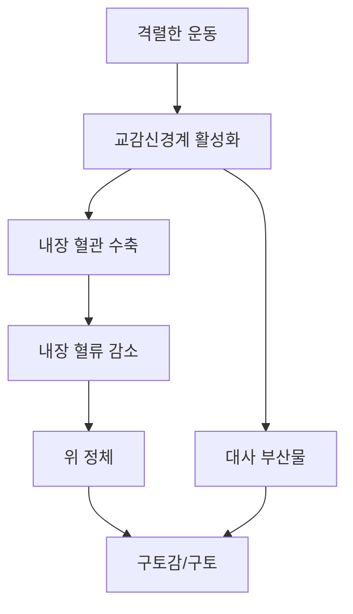

# 운동 중 구토의 과학: 한계에 도전할 때 몸이 아픈 이유

고강도 운동을 즐기는 사람들 사이에서는 익숙한 풍경이 있습니다. 격렬한 운동을 마친 선수가 바닥에 쓰러지거나, 장거리 달리기를 마친 주자가 결승선을 통과하자마자 허리를 굽히고 헛구역질을 하는 모습입니다. 흔히 "운동을 제대로 했다"는 증거로 치부되기도 하지만, 운동으로 유발되는 구토감은 생리학적 반응으로서 좀 더 면밀히 살펴볼 필요가 있습니다.

격렬한 신체 활동에 대해 우리 몸이 왜 구토로 반응하는지 이해하려면 소화기계, 신경계, 그리고 순환계의 요구 사이에서 일어나는 복잡한 상호작용을 들여다봐야 합니다.

## 생리학적 메커니즘: 왜 소화기관은 작동을 멈추는가

고강도 인터벌 트레이닝(HIIT), 고중량 웨이트 트레이닝, 혹은 지구력 달리기 등을 수행할 때 우리 몸은 엄청난 자원 재분배를 겪습니다. 이는 주로 자율신경계의 '투쟁-도피(fight or flight)' 반응에 의해 조절됩니다.

### 1. 내장 혈류 감소(Splanchnic Hypoperfusion, "장기 셧다운")
휴식 상태에서는 혈액량의 상당 부분이 영양분을 처리하기 위해 소화기관으로 향합니다. 그러나 격렬한 운동을 하면 우리 몸은 골격근과 심장에 우선순위를 둡니다. 이를 위해 몸은 내장 영역(위와 장에 혈액을 공급하는 혈관)에 혈관 수축을 유발합니다.

내장 혈류 감소라고 알려진 이 현상은 장 내벽의 허혈 상태를 초래할 수 있습니다. 충분한 혈액 공급을 받지 못한 위장은 사실상 "작동을 멈추게(shut down)" 되며, 이는 구토감, 경련, 심지어 구토 증상으로 이어집니다.

### 2. 교감신경계의 과부하
강도 높은 운동은 아드레날린과 같은 카테콜아민의 급격한 분비를 유발합니다. 이러한 호르몬은 근육이 활동할 준비를 하게 만들지만, 동시에 위 배출과 장 운동을 억제합니다. 만약 위장에 음식물이 남아 있다면, 이 음식물은 소화되지 않은 채 그대로 머물게 되며, 뇌는 이를 신체적 불편함으로 인식하여 배출하라는 신호를 보낼 수 있습니다.

### 3. 대사 변화
운동 강도가 높아질수록 신체는 산소를 사용하지 않고 포도당을 분해하는 무산소 대사에 더 많이 의존하게 됩니다. 이 과정에서 대사 부산물이 축적될 수 있습니다. 우리 몸의 화학수용체는 혈액 화학 성분의 변화를 감지하며, 항상성을 회복하기 위한 보호 기제로 구토 반사를 유발할 수 있습니다.

## 비교: 정상적인 생리학적 반응 vs 임상적 경고 신호

운동 강도에 따른 일시적인 반응과 기저 질환의 신호를 구분하는 것은 매우 중요합니다.

| 구분 | 운동 유발 구토 (일반적) | 임상적 경고 (주의 필요) |
| :--- | :--- | :--- |
| **발생 시점** | 최고 강도 운동 중 또는 직후 | 낮은 강도에서도 지속적으로 발생 |
| **지속 시간** | 15~30분 이내에 가라앉음 | 수 시간 또는 수일간 지속 |
| **동반 증상** | 가벼운 어지럼증, 거친 호흡 | 흉통, 실신, 혼란, 혈토 |
| **원인** | 혈류 재분배 | 심장 문제, 전해질 불균형, 열사병 |

## 실질적인 사례와 완화 전략

만약 구토감을 자주 느낀다면, 흔한 유발 요인들을 고려하여 루틴을 조정해 보십시오.

*   **"운동 전 식사"의 함정:** 고강도 세션 직전에 많은 양의 식사를 하는 것은 구토의 주된 원인입니다. 위장은 근육과 혈류를 얻기 위해 경쟁해야 하는 상황에 놓이기 때문입니다.
    *   *전략:* 운동 전에는 소화가 잘 되는 단순 탄수화물을 섭취하고, 단백질이나 지방이 많은 식사는 운동 후 회복기에 섭취하십시오.
*   **탈수와 전해질:** 탈수는 혈장량을 감소시켜 심장이 근육과 피부(체온 조절용) 모두에 혈액을 보내기 어렵게 만듭니다. 또한, 장시간 활동 중에는 나트륨 수치가 감소하는 운동 관련 저나트륨혈증이 발생할 수 있습니다.
    *   *전략:* 체액과 전해질 균형을 유지하기 위해 적절한 전해질 섭취를 보장하십시오.
*   **급격한 강도 상승:** 심혈관 기초 체력 없이 고강도 프로그램에 뛰어드는 것은 자율신경계에 충격을 줄 수 있습니다.
    *   *전략:* 점진적 과부하 원칙을 사용하여 신체의 혈관계가 고강도 운동의 요구에 적응할 수 있도록 시간을 주십시오.

### 인포그래픽: 구토 피드백 루프

## 의료기관을 찾아야 할 때
격렬한 운동 후 가벼운 구토감은 흔히 발생할 수 있지만, 이것이 일상적으로 반복되어서는 안 됩니다. 만약 구토와 함께 흉통, 심한 두통, 의식 상실이 동반된다면 즉시 운동을 멈추고 의료진의 진찰을 받아야 합니다. 이는 심장 문제나 심각한 전해질 장애와 같은 위험한 상태를 나타내는 지표일 수 있습니다.

결론적으로, 운동으로 유발되는 구토는 현재의 운동 강도가 비필수 장기에 산소를 공급할 수 있는 신체의 생리학적 능력을 앞질렀다는 신호인 경우가 많습니다. 영양, 수분 섭취, 그리고 훈련 강도를 체계적으로 관리함으로써 이러한 증상을 최소화하고 지속 가능한 성과를 얻는 데 집중하시기 바랍니다.

## 참고자료

- [Euphoria](https://en.wikipedia.org/wiki/Euphoria)
- [Exercise](https://en.wikipedia.org/wiki/Exercise)
- [Vomiting](https://en.wikipedia.org/wiki/Vomiting)
- [Exercise-induced nausea](https://en.wikipedia.org/wiki/Exercise-induced%20nausea)
- [502 Functional Splanchnic Hypoperfusion Precedes Intestinal Epithelial Cell Damage During Strenuous Exercise](https://doi.org/10.1016/s0016-5085(10)60328-9)
- [Figure 2: CHO oxidation rate during high intensity intermittent exercise.](https://doi.org/10.7717/peerj.3769/fig-2)
- [Effect of prior eccentric exercise on muscle lactate accumulation during high intensity exercise](https://doi.org/10.31274/rtd-20200716-17)