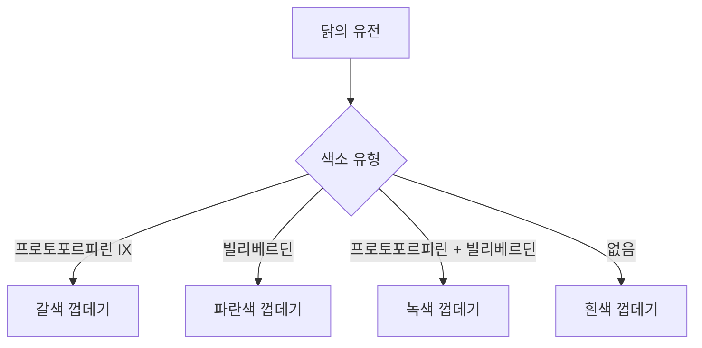

# 껍데기의 스펙트럼: 달걀 색깔이 다양한 이유와 건강에 미치는 영향

마트의 유제품 코너에 들어서면 우리는 흔히 다양한 색깔의 달걀이 담긴 카트들을 마주하게 됩니다. 깨끗한 흰색부터 짙은 갈색, 점박이가 있는 파란색, 심지어 올리브색까지 그 종류도 다양합니다. 많은 소비자에게 흰색 달걀과 갈색 달걀 사이의 선택은 일종의 미신에 둘러싸여 있습니다. 갈색 달걀이 더 "자연적"이라거나, 혹은 더 건강하고 영양가가 높다는 식의 믿음이 대표적입니다.

달걀의 색깔이 왜 다른지 이해하려면 카트 너머의 닭의 생물학적 특성을 살펴봐야 합니다. 이러한 메커니즘을 이해하는 것은 단순한 호기심을 충족시키는 것을 넘어, 우리가 식탁에 올리는 음식에 대해 현명한 결정을 내리는 데 도움을 줍니다.

## 생물학적 메커니즘: 닭은 어떻게 달걀에 색을 입히는가

달걀 껍데기의 색깔은 거의 전적으로 닭의 유전에 의해 결정됩니다. 껍데기 색깔과 관계없이 모든 달걀은 닭의 난관 안에서 처음 만들어질 때는 흰색입니다. 색소는 달걀 형성 과정의 마지막 단계에서 껍데기에 입혀집니다.

### 색소 침착 과정
달걀의 색깔을 결정하는 주요 색소는 프로토포르피린 IX(protoporphyrin IX)와 빌리베르딘(biliverdin)입니다.

1. **흰색 달걀:** 이 달걀들은 색소가 없습니다. 닭의 유전자가 달걀이 자궁을 통과할 때 껍데기에 색소를 침착시키지 않도록 설정되어 있기 때문입니다.
2. **갈색 달걀:** 이 달걀들은 헤모글로빈에서 유래한 색소인 프로토포르피린 IX로 덮여 있습니다. 이 색소는 달걀 형성의 마지막 몇 시간 동안 껍데기에 입혀집니다.
3. **파란색 및 녹색 달걀:** 이 색깔들은 적혈구가 분해되면서 생성되는 색소인 빌리베르딘에 의해 만들어집니다. 아라우카나(Araucana)나 아메라우카나(Ameraucana) 품종이 낳는 파란색 달걀은 껍데기 전체에 이 색소가 침착됩니다. 녹색 달걀은 일반적으로 파란색 달걀을 낳는 닭이 그 위에 갈색 프로토포르피린 층을 추가로 입히면서 올리브색이나 이끼 같은 색을 띠게 된 결과입니다.

### 색소 침착 과정 시각화
다음 다이어그램은 닭의 유전과 색소 침착 사이의 관계를 보여줍니다.

## 영양학적 미신과 과학적 진실

흔한 오해 중 하나는 달걀 껍데기의 색깔이 달걀의 영양 성분을 결정한다는 것입니다. 엄격한 생물학적 및 화학적 관점에서 볼 때, 껍데기 색깔과 영양 가치 사이에는 아무런 연관성이 없습니다.

단백질, 비타민, 미네랄을 포함한 달걀의 영양 함량은 주로 닭의 사료와 사육 환경에 의해 결정되며, 껍데기 색깔과는 무관합니다. 특정 영양소가 풍부한 사료를 먹고 자란 닭은 일반적인 곡물 사료를 먹은 닭과 다른 영양 성분을 가진 달걀을 낳게 되는데, 이는 해당 닭이 흰색 달걀을 낳든 갈색 달걀을 낳든 상관없이 동일하게 적용됩니다.

### 달걀 껍데기 특성 비교표

| 특징 | 흰색 껍데기 | 갈색 껍데기 | 파란색/녹색 껍데기 |
| :--- | :--- | :--- | :--- |
| **주요 색소** | 없음 | 프로토포르피린 IX | 빌리베르딘 |
| **영양 가치** | 동일 | 동일 | 동일 |
| **주요 품종** | 레그혼 | 로드 아일랜드 레드 | 아메라우카나 |

## 역사적 및 경제적 배경

왜 어떤 지역에서는 흰색 달걀이, 또 다른 지역에서는 갈색 달걀이 많이 보일까요? 그 답은 주로 경제적, 문화적 요인에 있습니다.

역사적으로 기후와 사료 공급 상황에 따라 지역별로 선호하는 품종이 달랐습니다. 미국의 경우, 화이트 레그혼(White Leghorn) 종이 산란 효율이 좋아 상업적 달걀 생산의 표준이 되었습니다. 이 품종이 흰색 달걀을 낳기 때문에 흰색 달걀이 상업적 표준으로 자리 잡게 된 것입니다. 세계의 다른 지역에서는 역사적으로 갈색 달걀을 낳는 더 덩치가 큰 품종들이 더 흔했습니다. 오늘날 특정 색깔을 선호하는 것은 영양학적 차이가 없음에도 불구하고, 단순히 문화적인 선호도에 기인하는 경우가 많습니다.

## 소비자를 위한 실용적인 고려 사항

마트에서 달걀을 고를 때 색깔은 무시해도 좋습니다. 대신 다음 요소들에 집중하십시오.

1. **생산 방식:** 닭의 사육 환경을 나타내는 라벨을 확인하십시오. 이는 달걀의 품질에 영향을 줄 수 있습니다.
2. **신선도:** '판매 기한'이나 '권장 소비 기한'을 확인하십시오. 달걀의 품질은 시간이 지남에 따라 저하됩니다.
3. **껍데기 상태:** 색깔과 관계없이 껍데기가 깨끗하고 금이 가지 않았는지 확인하십시오. 금이 간 틈으로 오염 물질이 달걀 내부로 들어갈 수 있기 때문입니다.

결론적으로, 지역 마트에서 볼 수 있는 다채로운 달걀들은 조류 유전학이 만들어낸 매혹적인 결과물입니다. 빌리베르딘과 프로토포르피린이라는 색소들이 아름다운 껍데기를 만들어내지만, 이는 단지 생물학적 부산물일 뿐입니다. 건강을 생각한다면 닭이 낳은 껍데기의 색깔보다는 닭의 사육 환경과 먹이에 더 관심을 기울이시기 바랍니다.

## 참고자료

- [Eggs as food](https://en.wikipedia.org/wiki/Eggs%20as%20food)
- [Egg](https://en.wikipedia.org/wiki/Egg)
- [Reptile](https://en.wikipedia.org/wiki/Reptile)
- [Eggshell (color)](https://en.wikipedia.org/wiki/Eggshell%20%28color%29)
- [Why Do Soils Have Different Colors and Smell?](https://doi.org/10.1007/978-3-031-50777-9_3)
- [Curious Kids: why do eggs have a yolk?](https://doi.org/10.64628/aa.qja7pr7nj)
- [Why do sunflowers have invisible colors?](https://doi.org/10.7554/elife.76105)